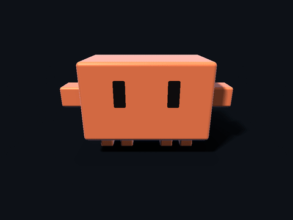

Hi, I'm DitZz, a frontend developer from Indonesia.

I build interfaces with TypeScript and React, and I write a lot of my code together with Claude. I also work on mobile with Flutter and on backends with Laravel and Node.js.

 

### Stack

| Area | Tools |
| --- | --- |
| Languages | TypeScript, JavaScript, C, Bash |
| Frontend | React, HTML, CSS, Tailwind CSS |
| Mobile | Flutter, Android |
| Backend | Node.js, Laravel |
| Data | MySQL, MongoDB, SQLite |
| Tooling | Git, Docker, Linux |

### GitHub

  
  

### Contact

[GitHub](https://github.com/andityaay-debug) · [Instagram](https://instagram.com/YOUR_INSTAGRAM) · [LinkedIn](https://linkedin.com/in/YOUR_LINKEDIN) · [Email](mailto:YOUR_EMAIL@gmail.com)
