  

### About

Hi, I'm **DitZz**, a frontend developer from Indonesia.

I build interfaces with TypeScript and React, and I write a lot of my code together with Claude. I also work on mobile with Flutter and on backends with Laravel and Node.js.

 

### Workflow

  

### Stack

  

### Activity

  
  

  

### Contact

  
  
  
  

